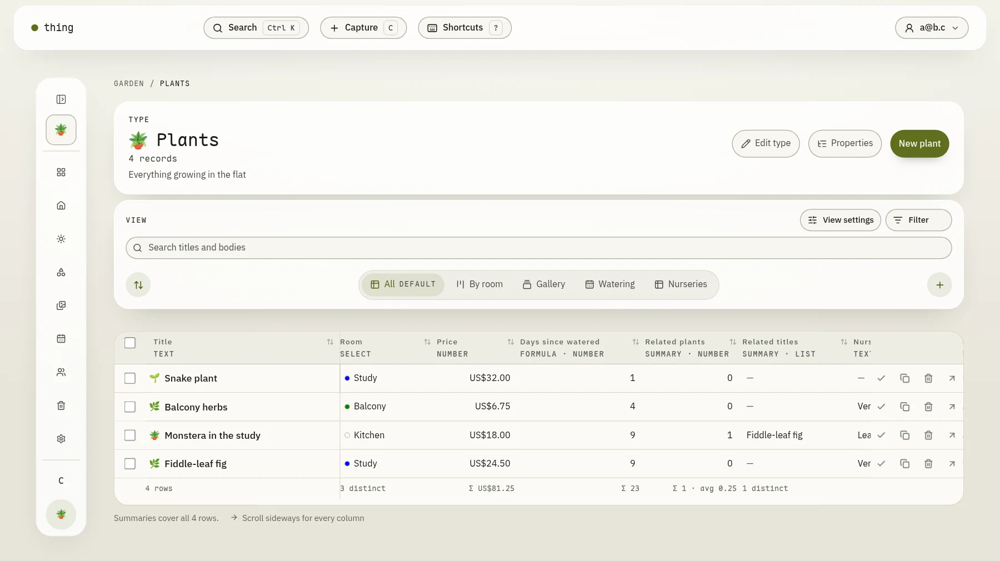
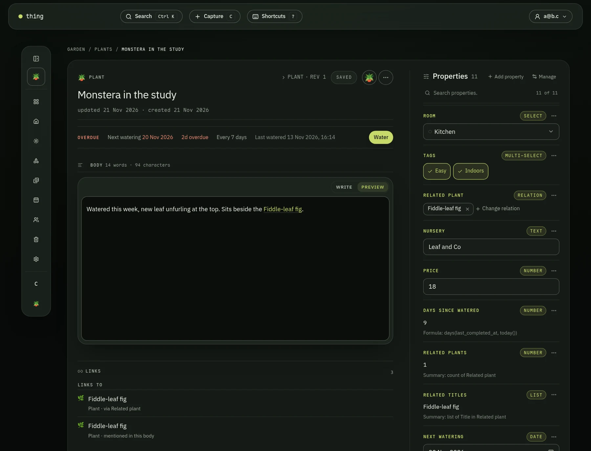
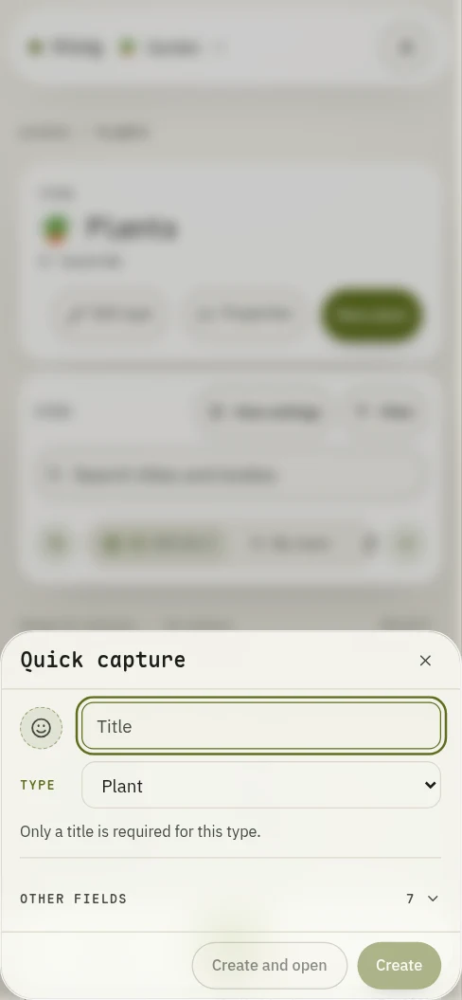
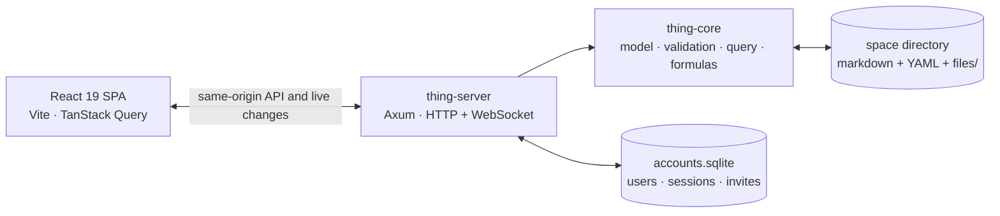

# thing

A self-hosted app for tracking things with your own schema. You define types and properties,
create records, and track them over time, alone or with other people in a shared space. Changes
reach other open clients in the space over a WebSocket without a reload. Each record and its schema
are stored as files on disk.

`thing` uses a spreadsheet model: **type = table, property = column, record = row, value = cell**.
You define the schema, and a property can also be a relation, formula or summary.

[](https://github.com/talonlikeaclaw/thing/actions/workflows/ci.yml)

<picture>
  <source media="(prefers-color-scheme: dark)" srcset="docs/assets/table-dark.webp">
  
</picture>

<p align="center"><em>The Plants type in the Garden demo space, with property columns, two calculated columns and five saved views.</em></p>

## Summary

- **Markdown storage.** One record is one `.md` file with YAML frontmatter. Attachment bytes are
  stored beside it. You can back up a space with `rsync`, search it with `grep`, version it with
  `git`, or edit its files in another editor.
- **User-defined schema.** Types and properties are created and changed in the app. Adding a
  property does not require a migration step, and a text column can be converted into a relation
  to a new type. A property can state the rules its values must hold, a type can require or
  prefill one, and a column can name a person in the space.
- **Saved views.** The same records can be shown as a table, a board, a gallery or a calendar,
  with saved columns, filters and sorts.
- **Journal and calendar.** A space can name a daily type, so each day is a record with its own
  address; a Calendar shows the month's notes beside the work due each day.
- **Self-hosted and shared.** One container serves the app. Accounts are stored in SQLite; space
  content stays in files. Spaces have owner, editor and viewer roles.

## Quick start

Docker and git are the only prerequisites.

```sh
git clone https://github.com/talonlikeaclaw/thing.git
cd thing

# On plain-HTTP localhost the session cookie must not be Secure.
echo 'THING_COOKIE_SECURE=false' > .env

docker compose up --build
```

Open **http://127.0.0.1:8080** and register. The first account on a fresh install becomes the
owner; later accounts join through a space invite link. `./data` holds all application state,
including the accounts database, markdown files and attachments, so back it up. Behind HTTPS,
leave `THING_COOKIE_SECURE` at its `true` default.

The image is also published as `ghcr.io/talonlikeaclaw/thing:latest`; the
[development guide](docs/DEVELOPMENT.md#production-container) covers the `docker run` security
settings, reverse proxies and every environment variable.

## The model

| Concept | Excel | Where it lives |
|---|---|---|
| **Type** | A table | `types/<key>.yml` — properties, schedule configuration and saved views |
| **Property** | A column | `properties/<key>.yml` — format, options, formula or summary |
| **Record** | A row | `objects/<type>/<slug>.md` — frontmatter plus one markdown body |
| **Value** | A cell | A frontmatter key; an unset value is an absent key, never `null` |
| **View** | A saved query | A block in the type's `.yml`; the selected view is in the URL |

A record on disk — `spaces/<uuid>/objects/plant/monstera-in-the-study.md`:

```
---
schema: 8
id: 01a1fff5-cf5d-73bd-8f81-f2e993ef20c0
type: plant
title: Monstera in the study
icon: 🪴
properties:
  room: kitchen
  price: 18.0
  recurrence: { kind: days, every: 7 }
  tags: [easy, indoors]
---

Watered this week, new leaf unfurling at the top. Sits beside the
[[plant/Fiddle-leaf fig]].
```

The UUID is the identity, so renaming or moving the file does not break a link. Property and type
keys are stable slugs; display names can be changed. If you edit a file in another editor, the
running app notices the change.

<p align="center">
  
</p>

## Features

### Types and properties

- Types and properties are edited on the record or on the schema page, and both can be searched.
- Formats are text, number, checkbox, date, date-time, select, multi-select, relation, recurrence,
  URL, email, file, image and attachments. `list` is computed-only.
- A calculated property is a **formula** over the record (`days(last_completed_at, today())`,
  `price * quantity`) or a **summary** over linked records (`count`, `sum`, `min`, `max`, `list`).
- Calculated properties use the same form as stored properties, are read-only, and are recomputed
  on read.
- Renaming a property updates every reference to it, and a referenced property cannot be deleted
  while it is named.

### Views

- Each type has named views: a table, a board grouped by a select property, a gallery with a
  property as its cover, and a calendar on a date property.
- Each view stores its columns, widths, filters and sorts. The selected view is in the URL.
- The table supports paging, multi-select, bulk edits, duplicate, move to trash with Undo, column
  pinning and a totals row.
- Tab moves through cells. Shift with an arrow selects a rectangle that can be copied as a
  spreadsheet block or a markdown table.

### Schedules

- A scheduled type has a due date and a repeat interval.
- Completing a record stores the completion date, moves the due date forward and appends a
  revision.
- Due and overdue are calculated as calendar days in the space's timezone.
- The space navigation shows an overdue count, and the Schedule page lists overdue, today and
  upcoming records.
- Reminders are in the app only; there are no emails, push notifications or background jobs.

### Writing and search

- A record has one markdown body. The editor has a toolbar, shortcuts, `/` commands, `[[`
  autocomplete and a split preview.
- `[[Type/Title]]` links resolve against live record titles. The Links panel and space graph show
  outgoing links, relation targets and mentions.
- `Cmd/Ctrl+K` searches titles and bodies and lists types, spaces and actions.
- `C` opens quick capture for the current type. `?` lists the shortcuts.

<p align="center">
  
</p>

### Files and spaces

- Files and images can be attached to a record or stored as a set in one property. Bytes live
  under the space's `files/` tree, named by SHA-256.
- Images have thumbnails, covers with a stored focal point, a lightbox, and a space library that
  lists the records using each file.
- An owner can rename or delete a space, change its timezone, choose one of six accent colors, and
  collect unused attachment bytes.
- CSV export, templates and dry-run import are included.

The complete feature list is in [`docs/FEATURES.md`](docs/FEATURES.md).

## Architecture



`thing-core` contains the domain model, file format, validation, query engine, schedule arithmetic
and formula evaluator. `thing-server` is the HTTP shell; a CLI, a Tauri desktop shell (wrapping
the same SPA bundle) and an MCP server can link the same core. The server builds an in-memory index
from the markdown files and can rebuild it, so the files remain canonical and the database holds
only accounts.

## Development

Rust `1.98.1` and Node 24.

```sh
THING_DATA_DIR=./data cargo run -p thing-server   # API on 127.0.0.1:8080

cd web && npm ci && npm run dev                   # SPA on localhost:5173, proxying /api

# With the server running, build the Garden demo space through the HTTP API.
THING_DATA_DIR=./data THING_SEED_PASSWORD=choose-a-real-one scripts/seed.sh

# Gates
cargo fmt --all --check
cargo clippy --workspace --all-targets -- -D warnings
cargo test --workspace
cd web && npm run test:run && npm run lint && npm run typecheck && npm run build
```

`docs/DEVELOPMENT.md` covers the dev container, LAN and Tailscale access, the production image's
security settings and environment variables, CSV through `curl`, the Semgrep scan, the reindex
command and the account CLI.

## Documentation

| Document | What it covers |
|---|---|
| [`docs/FEATURES.md`](docs/FEATURES.md) | Every shipped feature in detail |
| [`docs/DEVELOPMENT.md`](docs/DEVELOPMENT.md) | Build, seed, test, containers, CSV, security |
| [`docs/ROADMAP.md`](docs/ROADMAP.md) | Milestones and what is landed |
| [`PRODUCT.md`](PRODUCT.md) | Users, positioning, principles, durable constraints |
| [`DESIGN.md`](DESIGN.md) | The Night Glass visual direction |
| [`AGENTS.md`](AGENTS.md) | Repository rules for agents working in the tree |

## Status

`0.9.3`, schema 8. Every schema-1…7 file still loads. `thing` is pre-1.0: the file format is
versioned, an unknown schema is refused rather than guessed at, and CI runs the Rust and web gates
plus Semgrep on every push.

## License

`thing` is licensed under the GNU Affero General Public License, version 3 only
(AGPL-3.0-only). See [`LICENSE`](LICENSE).
